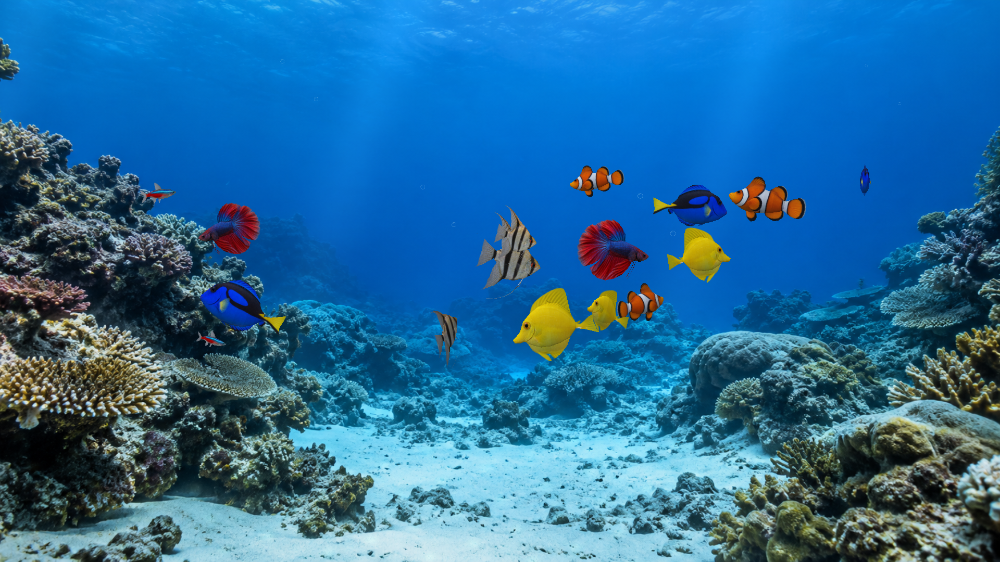
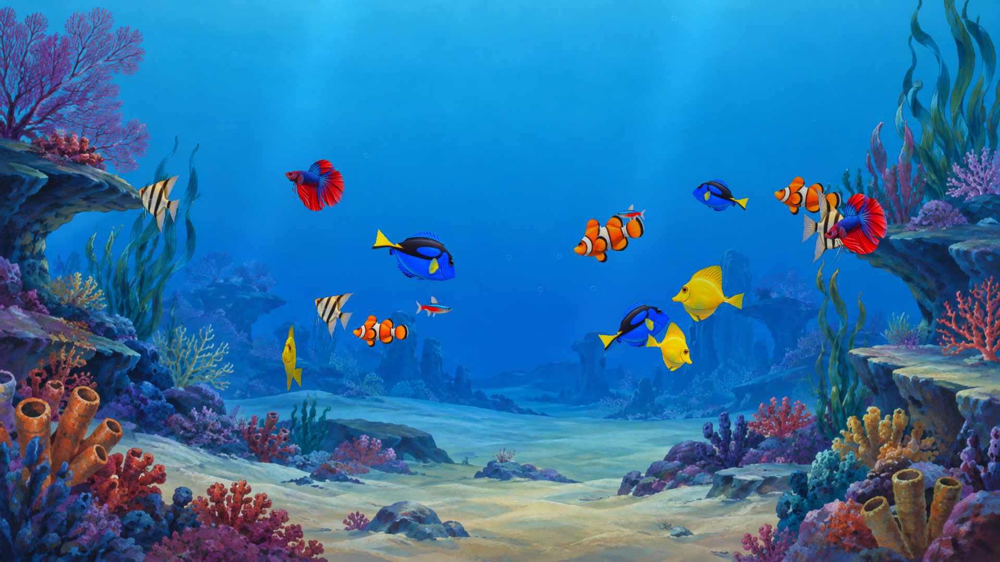
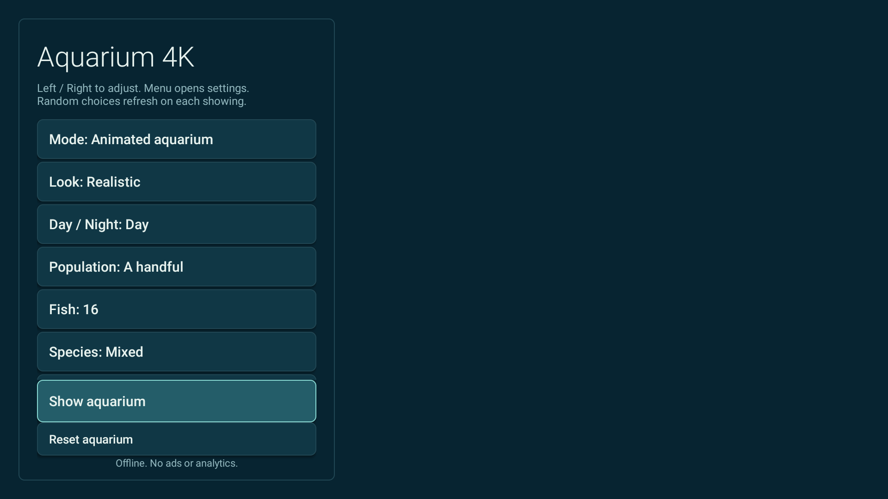

<p align="center">
  <a href="https://github.com/jeremykenedy/fire-tv-aquarium#gh-light-mode-only"><picture><source media="(max-width: 600px) and (prefers-reduced-motion: reduce)" srcset="art/banner-mobile-still-light.4ef0c2bdf5ed.svg"><source media="(prefers-reduced-motion: reduce)" srcset="art/banner-still-light.5e60a932b856.svg"><source media="(max-width: 600px)" srcset="art/banner-mobile-light.d679d55b0165.svg"></picture></a>
  <a href="https://github.com/jeremykenedy/fire-tv-aquarium#gh-dark-mode-only"><picture><source media="(max-width: 600px) and (prefers-reduced-motion: reduce)" srcset="art/banner-mobile-still-dark.fdee691fd14c.svg"><source media="(prefers-reduced-motion: reduce)" srcset="art/banner-still-dark.c7de54eabab8.svg"><source media="(max-width: 600px)" srcset="art/banner-mobile-dark.9b72349c831e.svg"></picture></a>
</p>

<p align="center">An offline aquarium screensaver for Fire TV, Android TV, and Google TV with three-dimensional fish, sea life, six looks, and sunlight.</p>

<p align="center">
    <a href="https://github.com/jeremykenedy/fire-tv-aquarium/releases"></a>
    <a href="https://github.com/jeremykenedy/fire-tv-aquarium/releases/latest"></a>
    <a href="https://github.com/jeremykenedy/fire-tv-aquarium/actions/workflows/tests.yml"></a>
    <a href="https://github.com/jeremykenedy/fire-tv-aquarium/actions/workflows/style.yml"></a>
    <a href="https://github.com/jeremykenedy/fire-tv-aquarium/actions/workflows/docs.yml"></a>
    <a href="https://github.com/jeremykenedy/fire-tv-aquarium/actions/workflows/security.yml"></a>
    <a href="LICENSE"></a>
</p>

<p align="center">
    <a href="https://github.com/jeremykenedy"></a>
    <a href="https://github.com/jeremykenedy/fire-tv-aquarium" title="Open the repository and click Star"></a>
    <a href="https://github.com/sponsors/jeremykenedy" title="Sponsor jeremykenedy"></a>
</p>

## Table of Contents

- [Features](#features)
- [Requirements](#requirements)
- [Installation](#installation)
- [Quick Start](#quick-start)
- [Upgrades and Restoration](#upgrades-and-restoration)
- [TV Support](#tv-support)
- [Screenshots](#screenshots)
- [Documentation](#documentation)
- [Privacy](#privacy)
- [License](#license)

## Features

| Feature | What you get | Guide |
|---|---|---|
| Textured 3D fish | Six distinct species with fins, depth and independent turns | [Artwork](docs/ARTWORK.md) |
| Natural movement | Wandering, pauses, loose schools and predator escape | [Configuration](docs/CONFIGURATION.md) |
| Larger animals | Three-dimensional sharks, humpbacks and dolphins with non-graphic feeding | [Configuration](docs/CONFIGURATION.md) |
| Personal aquarium | Six looks, five environments, 0-60 fish, lighting, size and speed | [Configuration](docs/CONFIGURATION.md) |
| Original footage | The original recorded aquarium loop, with Day / Night and a clock | [Configuration](docs/CONFIGURATION.md) |
| Saved choices | Fixed or Random options, shuffle exclusions and exact settings transfer | [Configuration](docs/CONFIGURATION.md) |
| TV controls | D-pad settings, full-screen preview and reversible screensaver selection | [Installation](INSTALLATION.md) |
| Offline operation | No accounts, ads, analytics, network permission or runtime downloads | [Privacy](#privacy) |

Realistic is the default. All looks use fish volume; natural and painted skins,
lighting and scenery give them different appearances. Octopuses, turtles, rays
and jellyfish retain animated artwork surfaces. Original footage is recorded
video, so fish and scenery controls apply to animated mode.

## Requirements

- Fire TV, Android TV or Google TV with Android API 23 or newer and OpenGL ES 2.0.
- Android Platform Tools (`adb`) and an authorized debugging connection to the TV.
- Python 3.10 or newer for the included installer.
- Internet access on the computer to download the release. The app stays offline.

The animated surface follows its actual app window. A supported 4K panel mode
alone does not establish a 4K window or composition. The tested Fire TV renders
at 1920x1080; native 3840x2160 output remains unverified. Recorded footage uses
the bundled HD copy when the active output or decoder cannot use UHD.

## Installation

Download the signed APK and checksum from the
[latest release](https://github.com/jeremykenedy/fire-tv-aquarium/releases/latest).
The installer verifies both assets, upgrades in place and selects the screensaver:

```bash
git clone https://github.com/jeremykenedy/fire-tv-aquarium.git
cd fire-tv-aquarium
mkdir -p build
gh release download --repo jeremykenedy/fire-tv-aquarium \
  --pattern aquarium-4k.apk --pattern aquarium-4k.apk.sha256 --dir build
adb connect DEVICE_IP:5555
python3 install.py --device DEVICE_IP:5555
```

GitHub CLI requires authentication; the public release downloads do not require
a GitHub account. Replace `DEVICE_IP` with the connected TV's address. For
another TV, give `--state-file` a separate path. See [Installation](INSTALLATION.md)
for developer mode, device pairing and manual downloads.

## Quick Start

Open **Aquarium 4K** from the TV app list. Up / Down selects a setting, Left /
Right adjusts it, and Select advances an option. **Show aquarium** opens the
preview. Menu or Back returns to settings; Back again exits.

Changes save immediately. Random choices roll once per showing and stay steady
for that session. A remote key exits the non-interactive idle screensaver.
See [Configuration](docs/CONFIGURATION.md) for every control and default.

## Upgrades and Restoration

Download the APK and checksum from the same release, then run the installer
again. The stable package and signing identity retain saved preferences.
Version 1.4.0 keeps the existing options and adds a strict local settings
interface for copying their exact stored values between TVs.

The installer preserves idle and sleep timeouts and keeps the first saved
screensaver backup. To restore the previous selection without deleting Aquarium:

```bash
python3 install.py --device DEVICE_IP:5555 --restore
```

Include the same `--state-file` used during installation. Android can reject an
older version code; restoring the previous screensaver is safer than uninstalling
an upgrade when preferences must survive. See [Installation](INSTALLATION.md).

## TV Support

| Platform | Current verification |
|---|---|
| Fire TV | Physical API 30: all six looks at about 30 presented FPS with 60 Large fish, five visitors, bubbles and sunlight; actual 1080p composition; Preview / Menu / Back / Home checked |
| Google TV | API 34 emulator: signed 1.4.0, six looks, recorded Day / Night footage and exact settings restoration at 1080p |
| Android TV | Same API 23+ APK; earlier API 31 emulator checks, final 1.4.0 hardware validation still needed |

A manually started normal DreamService ran for at least 45 seconds. That does
not prove automatic inactivity activation. Vendor screensaver restrictions and
protected idle timers require separate device checks. See [Verification](docs/VERIFICATION.md).

## Screenshots

Current signed 1.4.0 captures at 1920x1080: representative Google TV emulator
scenes and the physical Fire TV settings panel. These are ordinary profiles,
not the maximum-population performance fixture.

<!-- markdownlint-disable MD033 -->
<table>
<tr>
<td width="33%"><br>Realistic</td>
<td width="33%"><br>Cartoon</td>
<td width="33%"><br>Settings</td>
</tr>
</table>
<!-- markdownlint-enable MD033 -->

See the [full gallery](docs/GALLERY.md) for all six looks and original footage.

## Documentation

- [Installation, upgrades, restore and uninstall](INSTALLATION.md)
- [Settings, defaults and exact settings transfer](docs/CONFIGURATION.md)
- [Screenshot gallery](docs/GALLERY.md)
- [Frequently asked questions](docs/FAQ.md)
- [Artwork and media resolution](docs/ARTWORK.md)
- [Architecture and lifecycle](docs/ARCHITECTURE.md)
- [Device verification and limitations](docs/VERIFICATION.md)
- [Troubleshooting](docs/TROUBLESHOOTING.md)
- [Building and signing](docs/BUILDING.md)
- [CI and quality checks](docs/CI.md)
- [Release process](docs/RELEASING.md)
- [Contributing](CONTRIBUTING.md)
- [Changelog](CHANGELOG.md)
- [Video source and license](MEDIA_LICENSE.txt)

## Privacy

Animation, video, preferences and time display stay on the TV. The APK requests
no permissions and includes no network clients or analytics. Local diagnostic
logs do not upload themselves. The exported app-owned settings interface accepts
only the documented non-secret aquarium choices; it cannot change system timers
or other apps' settings.

The software and original animated assets use MIT. The recorded video has the
separate [Pixabay Content License](MEDIA_LICENSE.txt). Repository CI services
analyze source outside the app and are not included in the APK.

## License

This package is open-sourced software licensed under the [MIT license](LICENSE).
