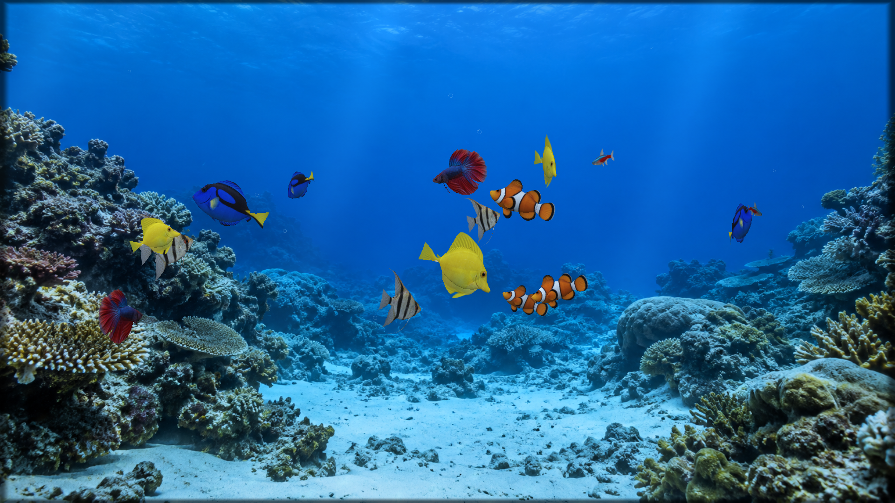
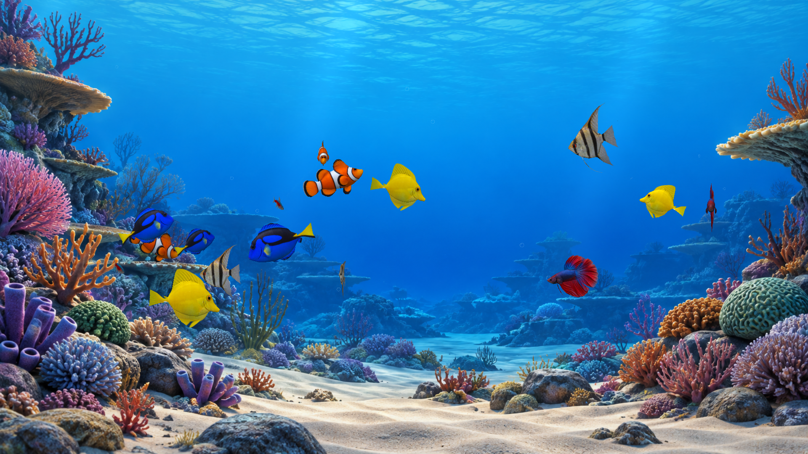
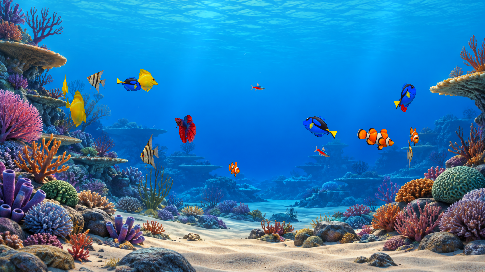
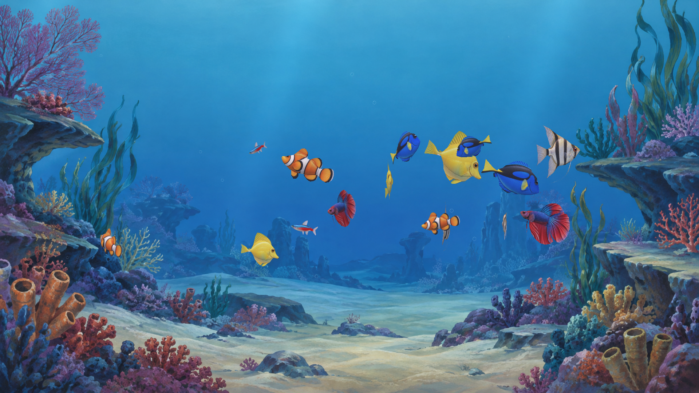
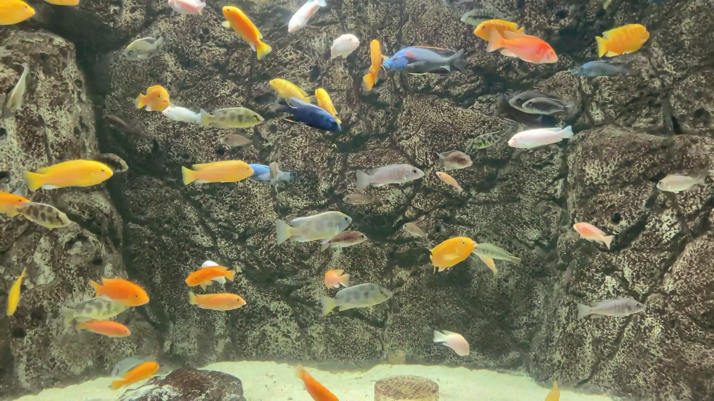
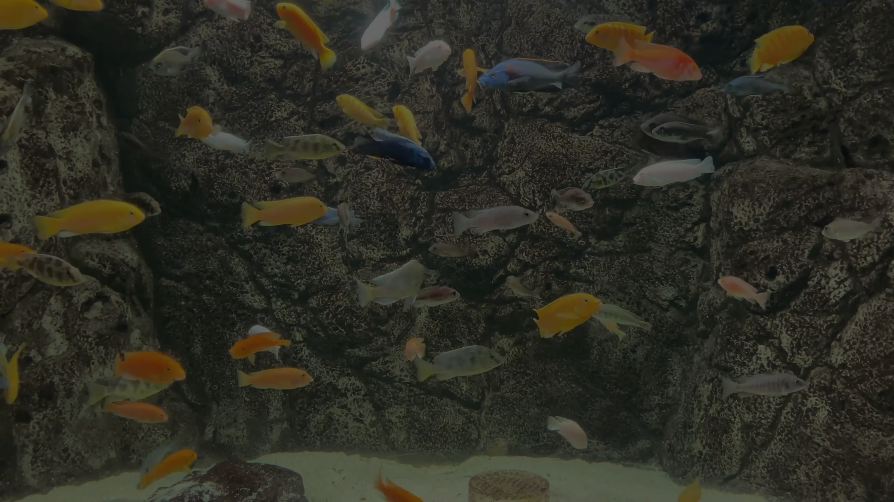

# Screenshot gallery

Captured October 22, 2026 from the signed 1.4.0 APK, SHA-256
`5e9b482e5238e183f8d8d07eeecd0b13b7cd411948937c39a0dfbc0806ba8eba`.
All captures are 1920x1080. The six looks and recorded footage use the Google TV
API 34 emulator; Settings uses the physical API 30 Fire TV. Animated scenes use
the ordinary 16-fish profile. See [Verification](VERIFICATION.md) for physical
maximum-load pacing and the limits of these captures. The final release only
refactors settings-update normalization; every rendering source and packaged
artwork byte matches this captured candidate.

<!-- markdownlint-disable MD033 -->
<table>
<tr>
<td width="33%"> Realistic</td>
<td width="33%"> Classic Windows aquarium</td>
<td width="33%"> Animated 3D</td>
</tr>
<tr>
<td width="33%"> Cartoon</td>
<td width="33%"> Finding Nemo inspired</td>
<td width="33%"> Little Mermaid inspired</td>
</tr>
<tr>
<td width="33%"> Settings</td>
<td width="33%"> Original footage: Day</td>
<td width="33%"> Original footage: Night</td>
</tr>
</table>
<!-- markdownlint-enable MD033 -->

[Back to the overview](../README.md)
